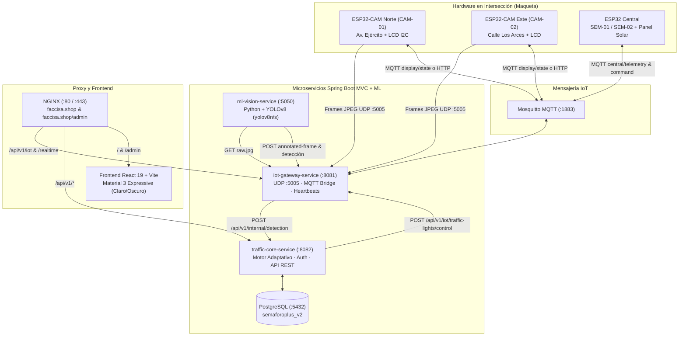
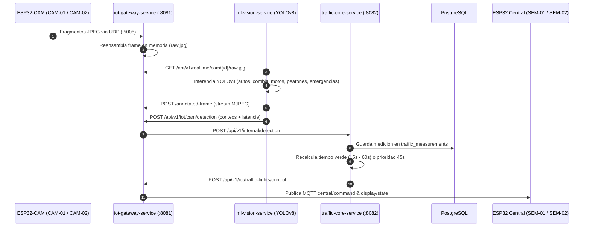
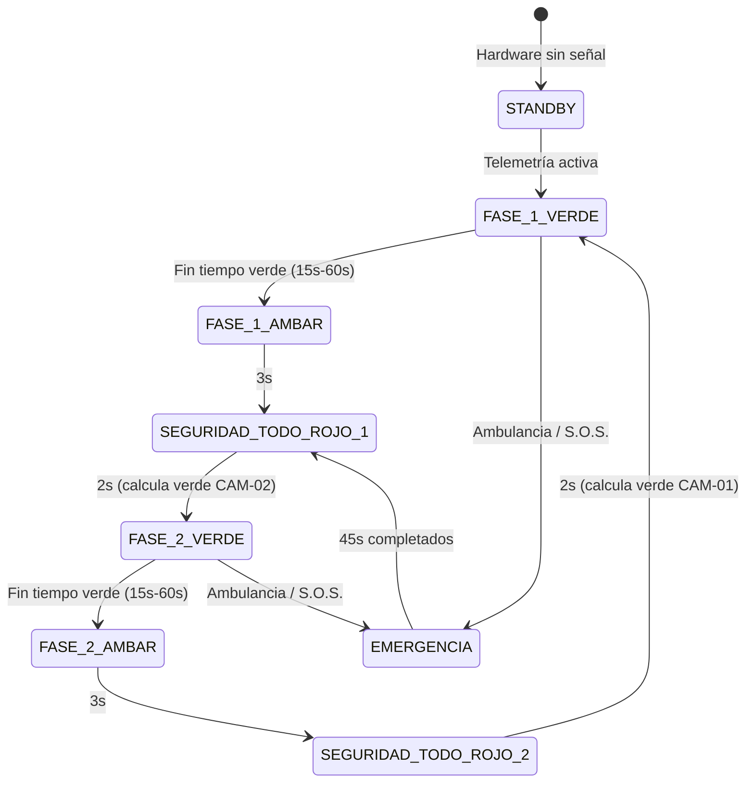
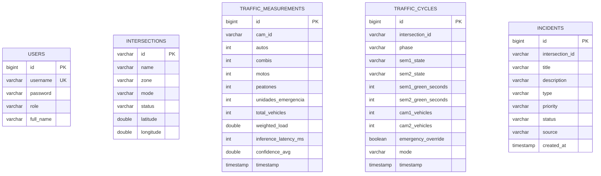
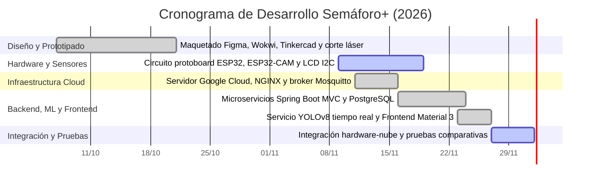

# Semáforo+ — Sistema Inteligente de Control Semafórico

Prototipo a escala de sistema inteligente de semáforos (**Semáforo+**) para reducir la congestión vehicular y los tiempos de espera en intersecciones urbanas de Arequipa (`Av. Ejército × Calle Los Arces`, Yanahuara), integrando **ESP32**, **ESP32-CAM**, visión artificial **YOLOv8**, comunicación **MQTT / UDP**, microservicios **Spring Boot MVC**, **PostgreSQL** y frontend **React + Material 3 Expressive**.

---

## 1. Diagrama de Arquitectura



---

## 2. Diagramas Principales

### 2.1 Flujo en Tiempo Real (Frame por Segundo → YOLOv8 → Semáforo)



### 2.2 Máquina de Estados del Semáforo Adaptativo



### 2.3 Modelo de Datos PostgreSQL (`semaforoplus_v2`)



---

## 3. Diagrama de GANTT del Proyecto



---

## 4. Qué hace cada Microservicio

| Componente | Tecnología | Puerto | Responsabilidad |
| :--- | :--- | :--- | :--- |
| `iot-gateway-service` | Spring Boot 3.4.2 MVC | `8081` / UDP `5005` | Recibe video UDP de `CAM-01` y `CAM-02`, puente MQTT con Mosquitto, control de *heartbeats* (`5s` cámaras, `10s` ESP32) y streaming MJPEG. |
| `traffic-core-service` | Spring Boot 3.4.2 MVC + JPA | `8082` | Motor adaptativo de semáforos (sin Node-RED), persistencia en PostgreSQL, autenticación Spring Security y APIs pública/admin. |
| `ml-vision-service` | Python + YOLOv8 | `5050` | Captura `raw.jpg`, clasifica vehículos/peatones/emergencias, dibuja *bounding boxes* y envía detecciones en tiempo real. |
| `frontend` | React 19 + Vite + Tailwind v4 | `5173` (dev) / NGINX | Portal ciudadano (`/`) y Centro de Control (`/admin`) con diseño Material 3 Expressive (Claro/Oscuro/Sistema). |

---

## 5. Despliegue en un Servidor (Google Cloud / Ubuntu / Debian)

### 5.1 Requisitos del Servidor
- **SO**: Linux (Debian / Ubuntu 22.04+)
- **Docker** `>= 24.0` y **Docker Compose** `v2`
- **Java 21 (JDK)**, **Maven 3.9+**, **Node.js 22+**, **Python 3.11+** (si se ejecuta fuera de Docker)
- **NGINX** y **Certbot** (para HTTPS en `faccisa.shop`)

### 5.2 Reglas de Firewall (Google Cloud VPC)
Abrir los siguientes puertos en la instancia:
- `80/TCP` (HTTP — necesario para ESP32/ESP32-CAM en `/api/v1/iot/` sin sobrecarga TLS)
- `443/TCP` (HTTPS — `faccisa.shop` y `faccisa.shop/admin`)
- `1883/TCP` (MQTT Mosquitto)
- `5005/UDP` (Streaming de video desde las dos `ESP32-CAM`)

### 5.3 Opción A: Despliegue con Docker Compose

1. Clonar el repositorio en el servidor:
   ```bash
   git clone https://github.com/Joxquin/SpringK-SemaforoPlus.git
   cd SpringK-SemaforoPlus
   ```
2. Construir el frontend para servir archivos estáticos desde NGINX (o añadir contenedor estático):
   ```bash
   cd frontend
   npm install
   npm run build
   cd ..
   ```
3. Levantar toda la pila (`postgres`, `mosquitto`, `iot-gateway-service`, `traffic-core-service`, `ml-vision-service`, `nginx`):
   ```bash
   docker compose up -d --build
   ```
4. Verificar estado de los contenedores:
   ```bash
   docker compose ps
   ```

### 5.4 Opción B: Despliegue en Host + NGINX (Producción con SSL)

1. **Base de datos PostgreSQL**:
   Crear la base de datos `semaforoplus_v2` con usuario `semaforo_user` y contraseña `semaforo_password_2026`.
2. **Backend Spring Boot**:
   ```bash
   cd iot-gateway-service && mvn clean package -DskipTests
   nohup java -jar target/iot-gateway-service-2.0.0.jar > iot-gateway.log 2>&1 &

   cd ../traffic-core-service && mvn clean package -DskipTests
   nohup java -jar target/traffic-core-service-2.0.0.jar > traffic-core.log 2>&1 &
   ```
3. **Microservicio ML (YOLOv8)**:
   ```bash
   cd ../ml-vision-service
   python3 -m venv .venv && source .venv/bin/activate
   pip install -r requirements.txt
   nohup python detector.py > ml-vision.log 2>&1 &
   ```
4. **Frontend React (Build de Producción)**:
   ```bash
   cd ../frontend
   npm install && npm run build
   sudo mkdir -p /var/www/semaforoplus
   sudo cp -r dist/* /var/www/semaforoplus/
   ```
5. **Configurar NGINX y SSL (`faccisa.shop`)**:
   - Usar `/var/www/semaforoplus` como `root` con `try_files $uri $uri/ /index.html;` para que funcionen `/` y `/admin/*`.
   - En puerto `80`, mantener `location /api/v1/iot/` haciendo `proxy_pass http://127.0.0.1:8081/api/v1/iot/;` sin redirección HTTPS para los microcontroladores ESP32.
   - En puerto `443` (SSL con Certbot):
     - `location /api/v1/iot/` → `http://127.0.0.1:8081/api/v1/iot/`
     - `location /api/v1/realtime/` → `http://127.0.0.1:8081/api/v1/realtime/` (con `proxy_buffering off;`)
     - `location /api/v1/` → `http://127.0.0.1:8082/api/v1/`
     - `location /` → `try_files $uri $uri/ /index.html;`
   - Emitir certificado SSL:
     ```bash
     sudo certbot --nginx -d faccisa.shop -d www.faccisa.shop
     sudo nginx -t && sudo systemctl reload nginx
     ```

### 5.5 Credenciales Iniciales
- **Administrador:** `admin` / `admin123` (`ROLE_ADMIN`)
- **Operador:** `operador` / `via2026` (`ROLE_OPERATOR`)

---

## 6. Estructura del Repositorio

```text
SpringK-SemaforoPlus/
├── docker-compose.yml
├── firmware/                  # Sketches .ino para ESP32 Central y ESP32-CAM (Norte/Este)
├── frontend/                  # React 19 + Vite + Tailwind v4 (Material 3 Expressive)
├── iot-gateway-service/       # Microservicio Spring Boot MVC (UDP :5005 + MQTT)
├── ml-vision-service/         # Microservicio Python + YOLOv8
├── mosquitto/                 # Configuración del broker MQTT
├── nginx/                     # Reverse proxy para faccisa.shop y /admin
└── traffic-core-service/      # Microservicio Spring Boot MVC + PostgreSQL + Motor Adaptativo
```
